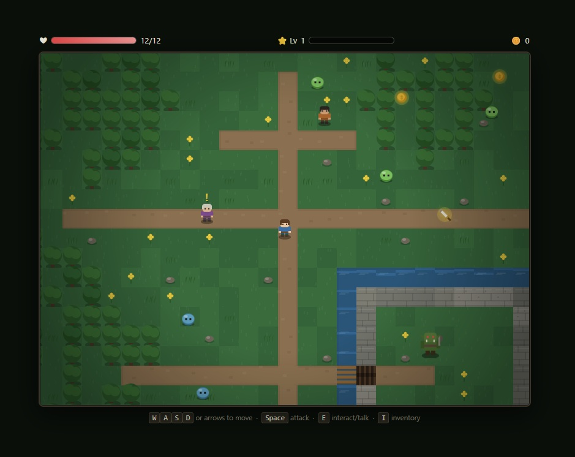
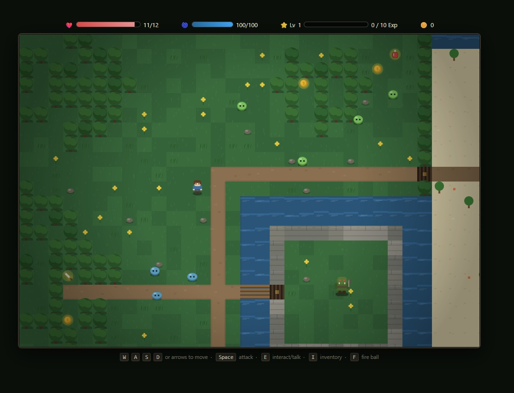
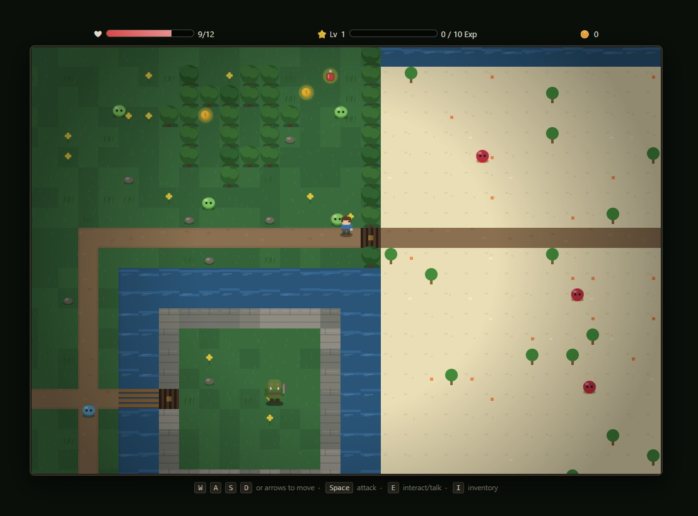
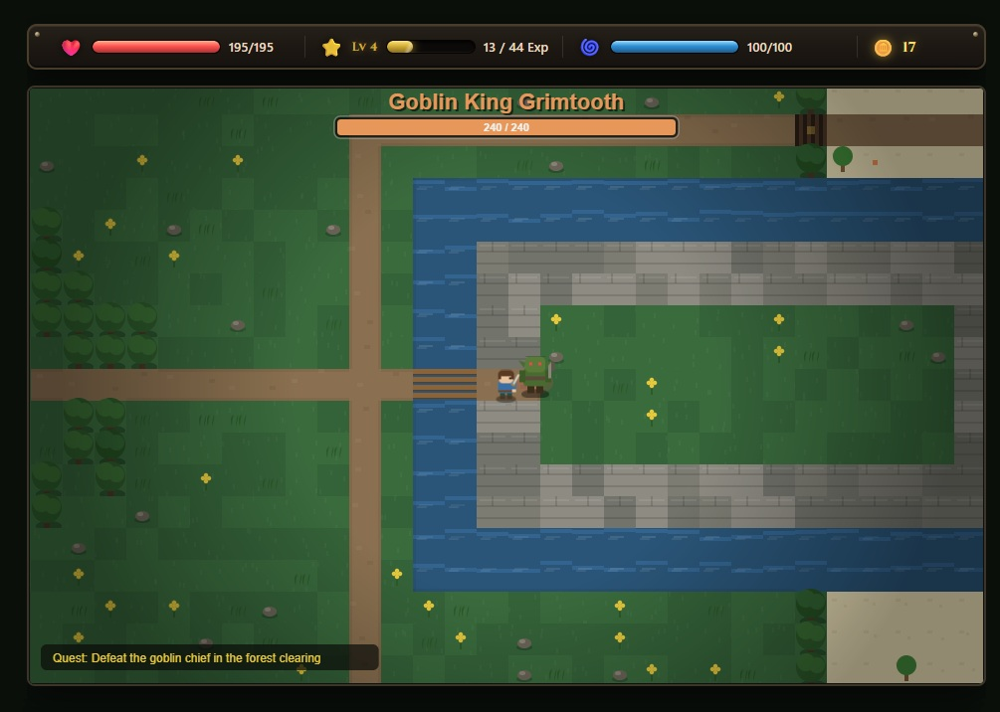
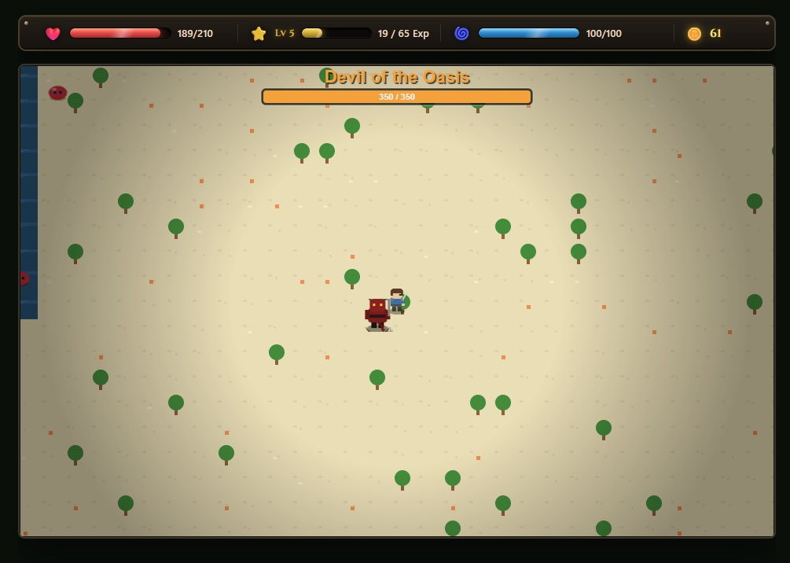
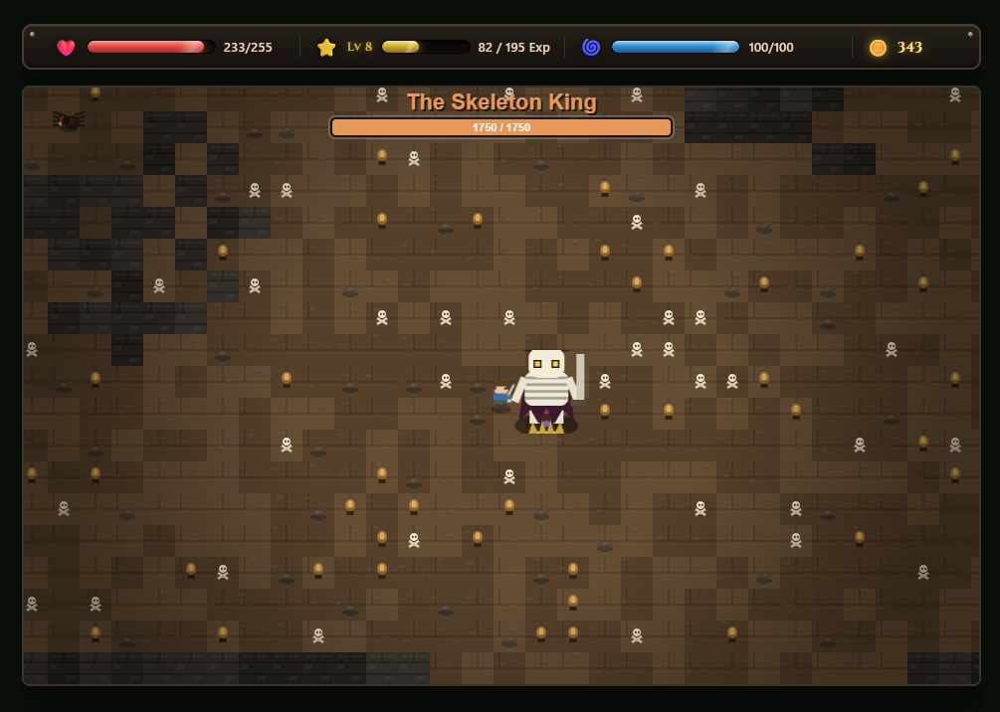
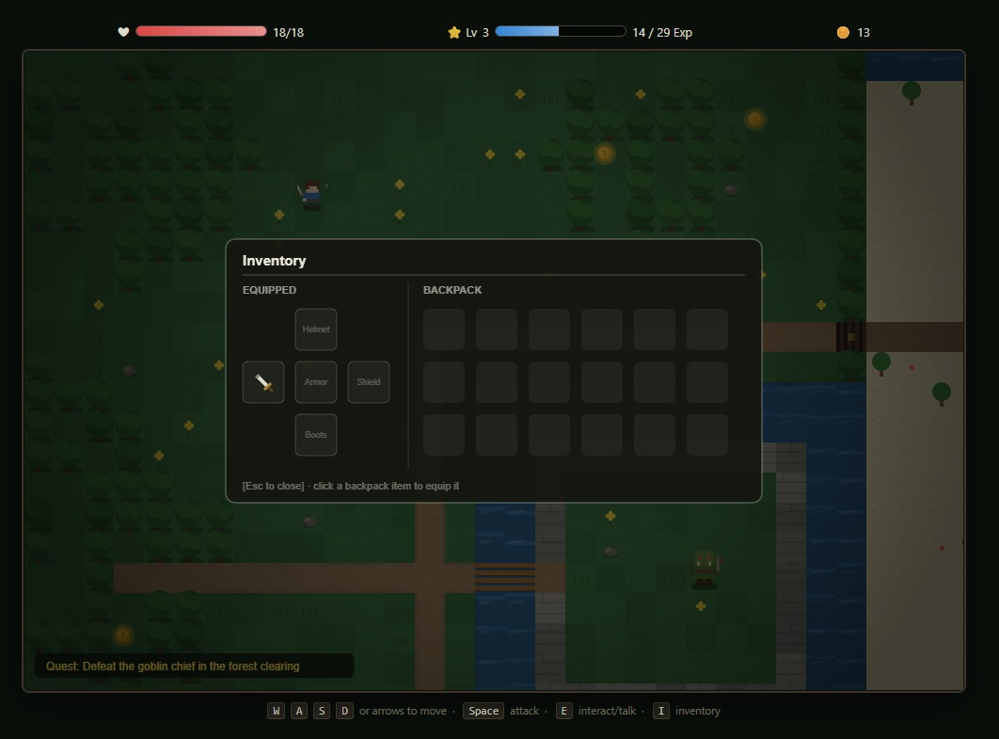

# Shattered Vale

A top-down action RPG built with vanilla JavaScript and HTML5 Canvas. It has no engine, no build step and no dependencies, and every sprite is drawn in code. Fight your way from a quiet grass valley through a desert oasis, a jungle, a skeleton crypt, a lava-filled underworld and a frozen mountain peak, defeating ten bosses on the way.

**▶ [Play in the browser](https://goldipl.github.io/Shattered-Vale-RPG/)**

## Screenshots

<table>
  <tr>
    <td width="50%" align="center">
      
      <br /><b>Start menu</b>
      <br /><sub>Title screen with Play, How to Play and Author buttons over the live world map.</sub>
    </td>
    <td width="50%" align="center">
      
      <br /><b>The village and forest</b>
      <br /><sub>The starting area: slimes, gold coins, a health potion and the walled castle by the river.</sub>
    </td>
  </tr>
  <tr>
    <td width="50%" align="center">
      
      <br /><b>Quest tracker</b>
      <br /><sub>The active quest is shown in the bottom-left corner. The Beach Oasis waits behind the gate to the east.</sub>
    </td>
    <td width="50%" align="center">
      
      <br /><b>Boss: Goblin King Grimtooth</b>
      <br /><sub>The first boss, guarding the castle courtyard. Bosses get a health banner at the top of the screen.</sub>
    </td>
  </tr>
  <tr>
    <td width="50%" align="center">
      
      <br /><b>Boss: Devil of the Oasis</b>
      <br /><sub>The desert boss of the Beach Oasis, surrounded by sand scorpions and red slimes.</sub>
    </td>
    <td width="50%" align="center">
      
      <br /><b>Boss: The Skeleton King</b>
      <br /><sub>A giant boss in the torch-lit Skeleton Dungeon. Defeating him opens the Lava Gate.</sub>
    </td>
  </tr>
  <tr>
    <td width="50%" align="center">
      
      <br /><b>Inventory</b>
      <br /><sub>Equipment slots, a backpack grid, character stats and item details.</sub>
    </td>
    <td width="50%"></td>
  </tr>
</table>

## Playing

You don't need to install anything. Use the [live version](https://goldipl.github.io/Shattered-Vale-RPG/), or double-click `index.html`. If your browser blocks local file access, serve the folder instead:

```bash
# from inside the shattered-vale-rpg folder
python3 -m http.server 8000
# then visit http://localhost:8000
```

The game needs a keyboard, so it shows a block screen on mobile devices.

## Controls

| Key                           | Action                                          |
| ----------------------------- | ----------------------------------------------- |
| `W` `A` `S` `D` or Arrow Keys | Move                                            |
| `Space`                       | Melee attack (hold to keep swinging)            |
| `F`                           | Cast a fireball (uses mana)                     |
| `E`                           | Talk to NPCs, interact, advance dialogue        |
| `I`                           | Open or close the inventory                     |
| `Esc`                         | Close the inventory, or go back to the start menu |

## How to play

1. Find **Elder Rowan** in the village and talk to him (`E`) to start the quest.
2. Visit the **Wandering Merchant** for a free health potion.
3. Head west and pick up the **Iron Sword** lying in the grass.
4. Clear the green and blue slimes to open the castle gate, then defeat **Goblin King Grimtooth**.
5. Each boss you defeat drops new gear and opens the gate to the next region. Defeat **Glacius, the Everfrost Wyrm** at the top of the Frostspire to win.

Your HP, mana, level/XP and gold are shown in the HUD above the game canvas. If your HP reaches 0, the game-over screen lets you restart. After winning you can keep exploring or start again.

## World and bosses

The world is a single 109 × 366 tile map with 143 enemies. Regions open one after another as you defeat their guardians:

| Region              | Boss(es)                                                 | Reward and what it opens                                                         |
| ------------------- | -------------------------------------------------------- | -------------------------------------------------------------------------------- |
| Village and forest  | Goblin King Grimtooth                                    | Iron Armor; opens the Beach Oasis                                                |
| Beach Oasis         | Devil of the Oasis                                       | Devil's Helmet, Legendary Sword; opens the Jungle                                |
| Jungle              | Orc Warlord Skarn, Jungle Witch Maera                    | Jungle Armor, Swift Boots; defeating both opens the Skeleton Dungeon             |
| Skeleton Dungeon    | The Skeleton King                                        | Bone Shield, Skeleton Crown, Mana Potion; opens the Lava Gate                    |
| Molten Depths       | Troll Chieftain, then The Pit Devil                      | Obsidian Armor, Molten Blade, Fireproof Boots; opens the Frostspire              |
| Frostspire          | The Frost Sentinel, Wraith Queen Isolde, then Glacius     | Frostplate Armor, Wraith Veil, Spectral Ward, Frostbrand, Frostwalker Boots, Winter's Grace; **victory** |

Two regions have floor hazards. Lava in the Molten Depths burns you unless you wear **Fireproof Boots**, and frostbite ice in the Frostspire hurts you unless you wear **Frostwalker Boots**.

## Features

- **Procedurally drawn sprites.** Layered, directional sprite sheets with walk cycles for the player, NPCs, 15 regular enemy types and all 10 bosses, plus 24×24 item icons. The game uses no image files.
- **Seven themed regions.** Grass, sand, jungle, crypt, lava and ice terrain, with edge blending between tile types, animated water shimmer and lava glow, and decorations for each region (flowers, shells, ferns, bones, braziers, obsidian shards, ice crystals).
- **Combat.** Melee hitboxes, mana-powered fireballs, telegraphed enemy attacks, knockback, hit flashes and per-enemy HP bars.
- **Boss fights.** A health banner with a low-HP warning pulse, plus unique drops and a short story cutscene for each boss.
- **Gated progression.** Gates open when guardians or bosses fall, and a quest tracker shows the current goal.
- **Leveling.** XP raises your level, max HP and attack. Mana regenerates over time.
- **Inventory.** Helmet, weapon, armor, shield and boots slots, a backpack grid, click-to-equip and click-to-unequip, a character stats panel, and consumables (Health Potion, Mana Potion, Winter's Grace).
- **Effects.** Hit bursts, floating damage/XP/gold numbers, camera shake, and full-screen flashes on level-ups, boss kills and gate openings.
- **Dialogue.** A typewriter-style dialogue box for NPC conversations and boss cutscenes.
- **Depth-sorted rendering**, so characters and items overlap correctly.
- **Menus.** A start menu with Play/Continue, Restart and Author buttons, a how-to-play panel, and game-over and victory screens.

## Architecture

```
├── index.html                      game canvas + DOM HUD (hp/mana/xp bars, level, gold); loads all 29 JS files in dependency order
├── css/style.css                   canvas and HUD styling
├── icons/favicon.ico
├── screenshots/                    images used in this README
├── test/
│   ├── dom-shim.js                 minimal DOM/canvas stand-in so the game runs under Node
│   └── run-tests.js                loads every game file in a vm sandbox and runs the smoke/regression tests
├── .github/workflows/static.yml    deploys the repo to GitHub Pages on every push to master
└── js/
    ├── utils.js                    shared math/canvas helpers (clamp, lerp, dist, rectsOverlap, roundRect, hashTile, makeCanvas, wrapPlainText)
    │
    ├── config/                     ← pure data: no rendering, no class instances
    │   ├── balance.js               every balance number: player stats, level-up curve, weapon/armor/boots bonuses, ENEMY_DEFS for all 25 enemy types, COMBAT_REWARDS, lava and frostbite damage
    │   ├── level-layout.js          NPC_DEFS (dialogue), WORLD_ITEM_PLACEMENTS, ENEMY_PLACEMENTS (143 enemies), BOSS_NAMES, PLAYER_SPAWN
    │   ├── item-stats.js            the stats and description shown for each item
    │   └── item-effects.js          pickup/equip/unequip effects, GATE_UNLOCK_CONDITIONS, BOSS_DEFEAT_EVENTS (drops, gate openings, cutscenes, victory)
    │
    ├── sprites/                    ← procedural pixel art
    │   ├── humanoid-sprites.js      palette-swappable humanoid sheets (player, elder, merchant) + sword overlay
    │   ├── monster-sprites.js       slimes, scorpion, spider, skeleton, and the Goblin/Devil/Orc/Witch/Skeleton King bosses
    │   ├── molten-sprites.js        Molten Depths creatures: lesser devil, orc raider, troll, Troll Chieftain, Pit Devil
    │   ├── frost-sprites.js         Frostspire creatures: frost wolf, crystal spider, wraith, yeti, ice golem, Frost Sentinel, Wraith Queen, Glacius
    │   ├── icon-sprites.js          24×24 item icons for world pickups and the inventory
    │   └── sprites.js               Sprites registry + initSprites(), which builds every sheet and icon once at boot
    │
    ├── world/
    │   ├── tilemap-builder.js       TileType enum, SOLID_TILES, GATE_DEFS, and terrain generation for every region
    │   ├── tilemap-renderer.js      tile ground rendering, edge blending and decorations
    │   └── tilemap.js               TileMap class: tile grid, gate state, bakes the static layer to an offscreen canvas, animates water and lava
    │
    ├── entities/
    │   ├── animated-sprite.js       shared sprite-sheet frame walker for 4-directional walk cycles
    │   ├── player.js                movement, melee/fireball combat, leveling, equipment bonuses, hazard immunities
    │   ├── npc.js                   talkable characters and their "Talk with me" speech bubble
    │   ├── enemy.js                 wander/aggro AI, telegraphed attacks and damage, driven by ENEMY_DEFS
    │   └── fireball.js              fireball projectile
    │
    ├── systems/
    │   ├── camera.js                smooth follow camera with screen shake, clamped to the map
    │   ├── particles.js             particle bursts + floating damage/XP/gold text
    │   ├── dialogue.js              typewriter dialogue box
    │   └── inventory.js             world item pickups + inventory panel (equip slots, backpack grid)
    │
    ├── ui/
    │   ├── hud.js                   DOM HUD bars, boss health banner, toast messages, quest tracker
    │   └── screens.js               desktop-only block screen, start menu, how-to-play panel, game-over/victory screens
    │
    └── core/
        ├── input.js                 keyboard state (keys/justPressed) + mobile detection
        ├── world-factory.js         turns level-layout.js data into live NPC/WorldItem/Enemy instances (at boot and on restart)
        ├── combat.js                interaction, melee hits, rewards, pickups, inventory clicks, gate checks, lava/frostbite hazards
        └── game.js                  bootstrap, main update/draw loop, restart logic, start-menu/victory flow
```

## Running the tests

The tests need [Node.js](https://nodejs.org/) and have no other dependencies:

```bash
node test/run-tests.js
```

They load all game files into a sandbox with a fake DOM, then check sprite generation, map layout, enemy counts, combat, boss progression, inventory and the restart/victory flow.

## Customizing

- **Add an enemy type.** Write a sprite builder in one of the `js/sprites/*-sprites.js` files and register it in `sprites.js`. Add its stats to `ENEMY_DEFS` and its XP/gold to `COMBAT_REWARDS` in `config/balance.js`. Place it on the map in `ENEMY_PLACEMENTS` in `config/level-layout.js`.
- **Add a boss.** Do the same as for an enemy, then add a display name to `BOSS_NAMES` and a defeat script (drops, gates, cutscene) to `BOSS_DEFEAT_EVENTS` in `config/item-effects.js`.
- **Expand the map.** Change the size in `new TileMap(...)` in `core/game.js` and add terrain in `world/tilemap-builder.js`.
- **Add dialogue or NPCs.** Edit `NPC_DEFS` in `config/level-layout.js`.
- **Add items.** Draw an icon in `sprites/icon-sprites.js`, describe it in `config/item-stats.js`, define its effects in `config/item-effects.js`, and place it with `WORLD_ITEM_PLACEMENTS` or as a boss drop.

## Browser support

Any modern browser with Canvas 2D support (Chrome, Firefox, Safari, Edge). Touch controls are not implemented, so you need a keyboard.

## License

Free to use, modify, and build on for any purpose.
